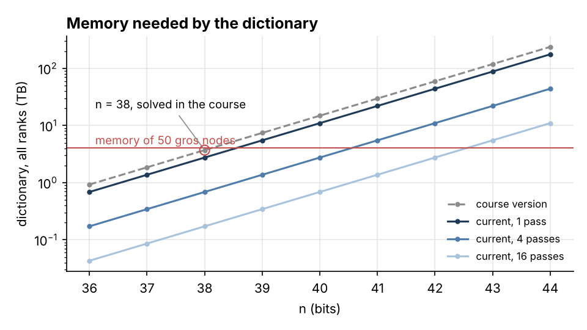
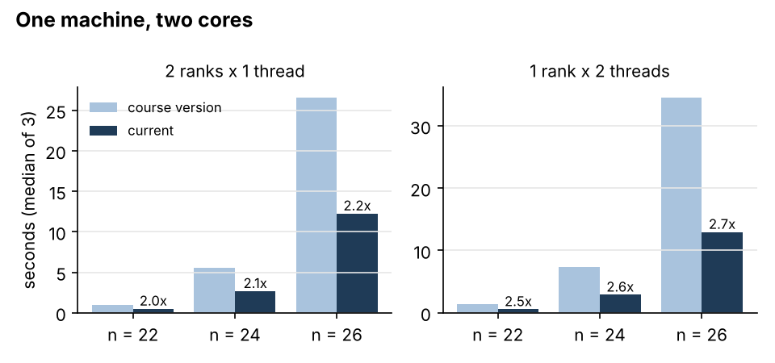
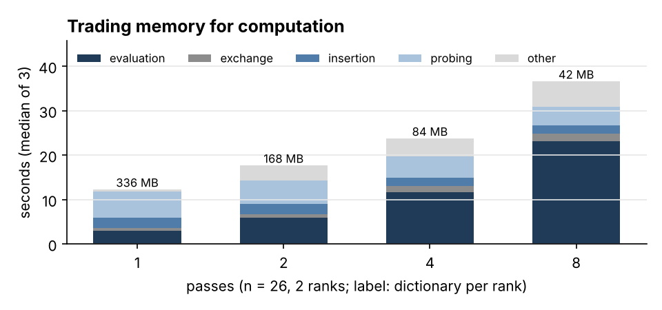

# Parallel meet-in-the-middle search

A distributed search for a "golden collision", in C with MPI and OpenMP. Given
two functions $f, g : \{0,1\}^n \to \{0,1\}^n$ and a predicate $\pi$, find
$(x, y)$ with $f(x) = g(y)$ and $\pi(x, y)$. The meet-in-the-middle algorithm
stores every $f(x)$ in a dictionary and looks up every $g(y)$: about
$3 \cdot 2^n$ operations instead of $2^{2n}$, but $2^n$ entries of memory,
which is what limits $n$.

With Adrien Panguel, as a course project, we solved $n = 38$ in 7 min 19 s on
50 nodes of Grid'5000. This repository keeps that version and continues from
it: the search now needs 26% less memory per key, exchanges half as much data,
and can split the dictionary into passes, which brings $n = 40$ within the
memory of the same 50 nodes.



*Memory taken by the dictionary over all ranks, by instance size. The red line
is the memory of the 50 nodes we used. Computed from the entry sizes, not
measured; see [scripts/projection.py](scripts/projection.py).*

## The problem

The instances come from double encryption. $f(k)$ encrypts a fixed plaintext
$P_0$ with Speck64/128 under the key $k$, $g(k)$ decrypts the matching
ciphertext $C_0$, and both keep the low $n$ bits of the 64-bit result. If
$C_0 = E_{k_2}(E_{k_1}(P_0))$, the two keys meet in the middle:
$f(k_1) = g(k_2)$. The predicate $\pi$ checks a second pair $(P_1, C_1)$ and
rules out the accidental matches.

## How the search is distributed

- **Sharding.** Rank $r$ owns the values $z$ with $z \bmod p = r$. Every rank
  computes $f$ on its slice of the key space, sends each pair to the owner of
  $z$, and the owner stores it. Each rank then holds about $2^n / p$ entries.
- **Blocks.** Keys are processed $2^{20}$ at a time per rank, so no buffer ever
  holds a full slice. All ranks run the same number of rounds.
- **Search on arrival.** The $g$ side follows the same route, and each
  received $g(y)$ is looked up immediately.
- **Threads.** Within a rank, OpenMP threads share the evaluation of $f$ and
  $g$, the insertions and the lookups.

## What changed after the course

| Change | Effect |
|---|---|
| Fingerprints from the middle state | $f$ and $g$ throw away $64 - n$ bits of the cipher state. Up to $63 - n$ of them are kept as a fingerprint, so a lookup only returns pairs that agree on far more than $n$ bits. The final check, two more encryptions, used to run about once per key; at $n = 26$ it now runs 3,424 times for $2^{26}$ keys. |
| One word per entry | An entry is $x + 1$ in the low $n + 1$ bits and the fingerprint above, 8 bytes instead of 12. At a load factor of 0.8 this is 10 bytes per key against 13.5. |
| One word per pair sent | The owner already knows $z \bmod p$ and which block each rank is processing, so a pair travels as $z / p$, the key's position in its block, and a fingerprint, in 64 bits. 16 bytes are exchanged per key instead of 32 (counted by the program). |
| Parallel insertion | Threads insert with a compare-and-swap on the slot; the table is zeroed by all threads first, so its pages are mapped in parallel; the next slots are prefetched during insertion and lookup. |
| Same number of rounds everywhere | In the course version each rank counted its own rounds. When two slice sizes fall on either side of a multiple of the block size, ranks disagree and the program hangs in a collective. With blocks of $2^{20}$ this needs unlucky values of $n$ and $p$ and never happened to us; with 16-key blocks, $n = 12$ and 17 ranks it does, and the test suite covers that case. |
| Passes | With `--passes K`, pass $j$ keeps only the values of $z$ in class $j$. Memory per rank is divided by $K$; $f$ and $g$ are evaluated $K$ times; the data exchanged stays the same. |

## Results

### Grid'5000, course version (measured)

Gros cluster: 36 logical cores and 96 GB of RAM per node. All parallel runs on
50 nodes.

| $n$ | Ranks | Threads per rank | Dictionary per rank | Time |
|---|---|---|---|---|
| 28 | 1 (sequential) | 1 | | 141.8 s |
| 28 | 100 | 9 | 36 MB | 1.1 s |
| 32 | 100 | 9 | 580 MB | 15.1 s |
| 34 | 100 | 9 | 2.3 GB | 60.5 s |
| 36 | 100 | 9 | 9.4 GB | 245.4 s |
| 38 | 100 | 9 | 37.1 GB | 1003.5 s |
| 38 | 900 | 20 | 4.1 GB | **438.6 s** |
| 38 | 900 | 36 | 4.1 GB | 584.7 s |

At fixed resources the time grows by a factor of about 4 per two bits, as the
work does. The sequential program stops at $n = 28$ for lack of memory.
All runs are in [results/grid5000_course.csv](results/grid5000_course.csv).

### One machine, course version against the current one (measured)

Two cores, Open MPI with `--bind-to none`, median of three runs, same
instances for both versions. Both find the planted solution in every run.



| $n$ | Layout | Course version | Current | Speed-up | Dictionary per rank |
|---|---|---|---|---|---|
| 26 | 2 ranks x 1 thread | 26.5 s | 12.2 s | 2.2x | 453 MB to 336 MB |
| 26 | 1 rank x 2 threads | 34.5 s | 13.0 s | 2.7x | 906 MB to 671 MB |

On one machine the exchange costs little, so this mostly measures the
evaluation, the hash table and the final checks. On a cluster the exchange
weighs more, and the gain will differ; it has not been measured there.

Splitting into passes trades memory for computation as expected:



### What larger instances would take (estimated, not run)

| $n$ | Passes | Dictionary, all ranks | Gros nodes needed |
|---|---|---|---|
| 38 | 1 | 2.7 TB | 34 |
| 40 | 4 | 2.7 TB | 34 |
| 42 | 16 | 2.7 TB | 34 |

The node count assumes 85% of a node's 96 GB is left for the table. For time,
take the measured 438.6 s at $n = 38$ and the measured factor of 4 per two
bits, for the work that does not depend on the number of passes: storing and
looking up entries, and moving them. Passes add evaluations of $f$ and $g$,
which cost about 43 ns each on the machine above. On 50 nodes this gives
roughly 30 to 35 minutes for $n = 40$ with 4 passes, and 3 to 4 hours for
$n = 42$ with 16 passes. These are extrapolations: none of these runs has been
done.

## What did not work as expected

- **More threads did not help on Grid'5000.** Our fastest run used 18 ranks
  of 20 threads on 36-core nodes, ten times more threads than cores, and 36
  threads per rank was slower still. The layout that matches the hardware,
  18 ranks of 2 threads, was not tried.
- **Threads can end up on one core.** Locally, Open MPI bound a single rank to
  one core by default, and its two OpenMP threads ran as one until
  `--bind-to none`. This may explain part of the previous point; without a
  cluster we cannot check.
- **The table was the bottleneck, not the cipher.** At $n = 26$ on one rank,
  lookups take more time than evaluating $f$ and $g$: a lookup that finds
  nothing walks a whole cluster of occupied slots. Lowering the load factor
  from 0.89 to 0.8 bought speed for 11% more memory.

## Repository layout

```
src/
  mitm.c          the search
  dict.h          hash table with one-word entries
  exchange.h      all-to-all exchange of packed pairs
  speck.h         Speck64/128
course/           the course version, unchanged
tools/
  gen_instance.c  instances with a planted solution
tests/
  run_tests.sh    correctness on small instances
bench/
  local_benchmark.sh
scripts/
  job_grid5000.sh batch job for OAR
  projection.py   memory needed for larger n
  figures.py
results/          measurements (CSV)
assets/           figures
```

## Building and running

Requires an MPI implementation with `mpicc` (tested with Open MPI), GCC with
OpenMP, and Python with pandas and matplotlib for the figures.

```sh
make                          # build/mitm and build/gen_instance
make test                     # 11 instances, n from 8 to 22

read C0 C1 K1 K2 <<< "$(build/gen_instance 26)"
OMP_NUM_THREADS=2 mpirun --bind-to none -np 1 build/mitm --n 26 --C0 $C0 --C1 $C1
# the solution printed is (K1, K2)

bench/local_benchmark.sh      # about 15 minutes on two cores
python3 scripts/projection.py
python3 scripts/figures.py
```

Options: `--passes K` splits the dictionary into $K$ passes, `--block B` sets
$2^B$ keys per rank and per block, `--load L` the load factor of the table.
The program prints the time spent evaluating, exchanging, inserting and
probing, the data exchanged, and the number of candidates checked.

On Grid'5000, edit the instance and the layout at the top of
[scripts/job_grid5000.sh](scripts/job_grid5000.sh), then
`oarsub -l nodes=50,walltime=01:00:00 ./scripts/job_grid5000.sh`.

## Context

The course version was written with Adrien Panguel for the parallel
programming course at Sorbonne University (supervisors El-Mehdi El Arar and
Alexandre Tabouret, winter 2025-26), from a sequential program provided with
the subject. Its design drew on the
[DMMA](https://github.com/gantz-thomas-gantz/DMMA) repository by
gantz-thomas-gantz. The first commit of this repository is that version;
everything after it came later.

## References

- W. Diffie and M. E. Hellman (1977). Exhaustive cryptanalysis of the NBS Data
  Encryption Standard. *Computer*, 10(6), 74–84.
- R. Beaulieu, D. Shors, J. Smith, S. Treatman-Clark, B. Weeks and L. Wingers
  (2013). The SIMON and SPECK families of lightweight block ciphers.
  Cryptology ePrint Archive, 2013/404.
- P. C. van Oorschot and M. J. Wiener (1999). Parallel collision search with
  cryptanalytic applications. *Journal of Cryptology*, 12(1), 1–28.

## License

MIT.
